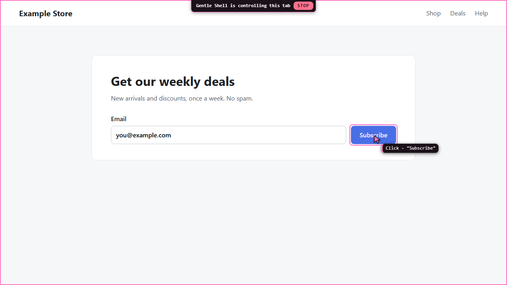
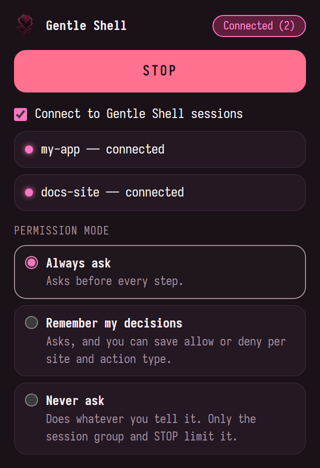

# Gentle Shell Browser

Gentle Shell Browser lets the AI agent in your Gentle Shell sessions use the Chrome you already have open, with your profile and your logins, while you stay in control. Each session works **only inside its own tab group**, you watch a pink cursor glide to everything it touches, a **STOP** button is always one click away, and **you choose a permission mode**: ask before every step, remember your decisions per site and kind of step, or never ask. It is a Pi package for Gentle Shell plus a Chrome extension, and they talk only over your own computer.

[Gentle Shell](https://github.com/Gentleman-Programming/gentle-shell) is a Pi-native terminal workspace for AI coding agents; this package adds a browser to it.

New here? Read the step-by-step **[user guide](docs/GUIDE.md)**, with pictures of the popup and the on-page cursor. Curious how it works inside? See **[the architecture notes](docs/ARCHITECTURE.md)**.

## Features

- **Browser tools for the agent:** `browser_tabs`, `browser_snapshot`, `browser_act` and `browser_screenshot` work in your real Chrome, with real input events, so pages behave as they do for you.
- **One tab group per session:** each session reads and acts only on the tabs in its own pink **Gentle · <session>** group. Drag a tab in to lend it, drag it out to take it back.
- **You see everything:** a ghost cursor glides to each target with a label of the step, your own mouse never moves, and **STOP** (on the page and in the popup) aborts the agent at once.
- **Three permission modes:** Always ask, Remember my decisions (saved allow or deny per site and kind of step) and Never ask. Only you change them; no agent tool can.
- **Risky page and action detection:** payments, transfers, deletions, passwords and security pages are recognized automatically and named in the prompt.
- **File uploads** into a page without Chrome's file dialog, with keys, passwords and credentials always refused.
- **WhatsApp watch:** a new message from a chat on your allow list wakes the session, and the agent answers in that chat on its own.
- **Automatic extension updates:** pull new code and the extension in Chrome updates and reloads itself.
- **Several sessions at once:** up to 100 Gentle Shell sessions, each with its own group, port and approval prompt.
- **Everything local:** each session listens on `127.0.0.1` only, and the extension and the session prove to each other that they know a secret token (an HMAC handshake) without ever sending it.

## Supported platforms

| Platform | Gentle Shell runs on | Chrome runs on | Install the extension and helper with |
|----------|----------------------|----------------|---------------------------------------|
| Linux | Linux | Linux | `npm run install-extension` |
| macOS | macOS | macOS | `npm run install-extension` |
| Windows | Windows | Windows | `npm run install-extension` |
| Windows + WSL2 | WSL2 | Windows | `scripts/install-extension.sh` |

## Requirements

- **Google Chrome 120 or newer**. On Linux and macOS, Chromium and other Chromium browsers work too (see `GENTLE_CHROME_NATIVE_HOSTS_DIR`); on Windows and WSL the helper is registered for Google Chrome only.
- **Node.js 22.18 or newer**, where Gentle Shell runs.
- **[Gentle Shell](https://github.com/Gentleman-Programming/gentle-shell)**.
- **git and npm**, to get the code and install its dependencies.

## Install

The [user guide](docs/GUIDE.md#3-install) walks through the same steps with checks and pictures.

### 1. Pi package

Get the code, install the dependencies once, then add the package to Gentle Shell's own Pi:

```sh
git clone https://github.com/AndySabina/gentle-shell-browser.git
cd gentle-shell-browser
npm install
~/.local/share/gentle-shell/install/bin/pi install "$PWD"
```

Keep this folder: the helper Chrome starts runs from it.

That is the private layout `gentle-ai shell install` creates (by default under `~/.local/share/gentle-shell/install`, called `<install>` below): `<install>/bin/pi install` adds the folder to the private agent's settings. `gentle-shell install "$PWD"` only works in the older layout: in this one `gentle-shell install` is the Gentle Shell installer itself and rejects a package path.

| Layout | Add the package |
|--------|-----------------|
| Private (`<install>/bin/pi`) | `<install>/bin/pi install "$PWD"` |
| Older layout (`~/.gentle-shell`) | `gentle-shell install "$PWD"` (older layout only), or add the folder to the `packages` list in `~/.gentle-shell/agent/settings.json` (older layout only; relative paths resolve from that file's folder), for example `{ "packages": ["/absolute/path/to/gentle-shell-browser"] }` |

Restart Gentle Shell. The bridge starts with the session: `/browser status` prints `Gentle Chrome: session "<name>" (<id>) listening on 127.0.0.1:<port>, Chrome not connected; the browser tools appear when it connects.` Each session takes the first free port from 48733 to 48832. (`Gentle Chrome:` is the prefix of every status line the package prints.)

### 2. Extension and helper

Run this once, from the cloned folder. It copies the extension to a folder Chrome can load and installs a small helper (a Chrome native messaging host) next to it, in `<folder>-host`. The helper tells the extension the secret token and the running sessions.

| Platform | Command | Default extension folder | Helper registered at |
|----------|---------|--------------------------|----------------------|
| Linux | `npm run install-extension` (or `scripts/install-extension.sh`) | `~/.local/share/gentle-shell-chrome` | `~/.config/google-chrome/NativeMessagingHosts/dev.gentle.shell.json`, plus `~/.config/chromium/NativeMessagingHosts/` when that Chromium folder exists |
| macOS | `npm run install-extension` (or `scripts/install-extension.sh`) | `~/Library/Application Support/gentle-shell-chrome` | `~/Library/Application Support/Google/Chrome/NativeMessagingHosts/dev.gentle.shell.json`, plus Chromium's when present |
| Windows | `npm run install-extension` | `%USERPROFILE%\gentle-shell-chrome` | Registry key `HKCU\Software\Google\Chrome\NativeMessagingHosts\dev.gentle.shell` |
| WSL2 | `scripts/install-extension.sh` | `%USERPROFILE%\gentle-shell-chrome` | Registry key `HKCU\Software\Google\Chrome\NativeMessagingHosts\dev.gentle.shell` |

To use another folder, pass it as the only argument: `npm run install-extension -- <folder>`, or `scripts/install-extension.sh 'D:\tools\gentle-chrome'` on WSL (a Windows or `/mnt/…` path). On WSL, `npm run install-extension` without a folder refuses and points to `scripts/install-extension.sh`.

- Everything is installed for your user only; no admin rights are needed. Only this extension may start the helper: its id is fixed by the `key` in the manifest. Registration paths come from your account's real home folder, not a redirected `$HOME`.
- For Brave, Edge, Vivaldi or another Chromium browser on Linux or macOS, set `GENTLE_CHROME_NATIVE_HOSTS_DIR` to that browser's `NativeMessagingHosts` folder; the helper manifest goes there instead of the default folders.
- The install refuses a non-empty folder that is not a previous copy (no `manifest.json` named "Gentle Shell Browser"), and never deletes anything. It writes only the extension folder, the helper folder next to it (`<folder>-host`), its records in the config folder, and the helper's registration (the manifest files or the registry key above).
- The helper starts the Node that ran the install. When a Gentle Shell reinstall or Node upgrade removes that Node, Chrome cannot start the helper. The session says so when it starts and in `/browser status`; `/browser update` rewrites the helper with the session's Node.
- On WSL, the script also picks the WSL distribution the helper starts; see [the architecture notes](docs/ARCHITECTURE.md#the-native-messaging-helper) and [Troubleshooting](#troubleshooting).

**Run it with your session's config folder.** The helper reads the token and the session list from one config folder, and Chrome starts it with your normal environment, not Gentle Shell's. So the install writes the folder it resolved into the helper. A Gentle Shell session with a private layout uses its own folder (for example `<install>/config/gentle-chrome`); `/browser status` prints it on its second line, with the command to run when the helper reads another one:

| Platform | Command |
|----------|---------|
| WSL2 | `GENTLE_CHROME_CONFIG_DIR='<config folder from /browser status>' scripts/install-extension.sh` |
| Linux, macOS | `GENTLE_CHROME_CONFIG_DIR='<config folder from /browser status>' npm run install-extension` |
| Windows (PowerShell) | `$env:GENTLE_CHROME_CONFIG_DIR='<config folder from /browser status>'; npm run install-extension` |

Without the variable, the install uses `$XDG_CONFIG_HOME/gentle-chrome` or `~/.config/gentle-chrome` of the terminal you run it in. There is one helper per user, so the last install decides which folder it reads; `/browser update` and automatic updates rebind it to the session that runs them.

### 3. Load the extension in Chrome

Once, in Chrome: `chrome://extensions` → turn on **Developer mode** → **Load unpacked** → choose the folder the install printed. Then ask the agent to open a page: it appears in a pink **Gentle · <session>** tab group. There is nothing to pair; sessions connect by themselves within 30 seconds, or at once when you open the popup.

Updates are automatic from then on: when the extension connects with another build than your checkout's, Gentle Shell copies the new files into its folder and asks it to reload itself. `/browser update` does the same on demand. An extension loaded before self-update existed asks you once to press the reload icon on the Gentle Shell Browser card in `chrome://extensions`.

## A quick look

While the agent works in a tab, you see what it does: a pink frame, a cursor that glides to the target, a label for each step and a **STOP** button. Your own mouse never moves, and the agent works in background tabs, so you keep browsing in yours.



The extension popup shows how many sessions are connected, the On/Off switch, the permission mode and STOP:



**[Continue in the full guide →](docs/GUIDE.md)** for [using it](docs/GUIDE.md#4-using-it), [permission modes and saved decisions](docs/GUIDE.md#5-permission-modes), troubleshooting and uninstalling.

## Use

Just ask, for example: "open github.com and find the latest issue in my repo". The agent opens tabs inside its group and you watch a rose ghost cursor glide to each target with a label of the action.

### Commands

| Command | Does |
|---------|------|
| `/browser` or `/browser status` | Shows this session's name, id and port, and whether Chrome is connected. A second line shows the session's config folder and whether the installed helper reads it (from the install's files; it does not ask Chrome). |
| `/browser start` | Starts the bridge (it also starts with the session). |
| `/browser stop` | Stops the bridge; Chrome disconnects. |
| `/browser update` | Copies the extension to its recorded folder now and reloads it in Chrome if it runs another build. |
| `/browser level` | Shows the permission mode. |
| `/browser level always` | Switches to Always ask. |
| `/browser level remember` | Switches to Remember my decisions. |
| `/browser level never` | Asks you to confirm, then switches to Never ask. |
| `/browser rules` | Lists the saved decisions, one per line: `site — kind: allow` or `deny`. |
| `/browser rules clear` | Asks you to confirm, then clears every saved decision. |
| `/browser rules clear <site>` | Clears the saved decisions for one site. |
| `/browser watch` | Shows whether the WhatsApp watch is on for this session and the chats on its allow list. |
| `/browser watch on` | Asks you to confirm, then switches the WhatsApp watch on for this session. |
| `/browser watch off` | Switches it off. |
| `/browser watch allow <chat name>` | Adds a chat to the allow list, as WhatsApp shows its name (spaces included; case does not count). |
| `/browser watch remove <chat name>` | Removes a chat from the allow list. |

### Tools the agent gets

The agent sees these tools only while Chrome is connected to its session; until then they cost no tokens. `/browser status` works either way.

| Tool | Does |
|------|------|
| `browser_tabs` | Lists the tabs in the group (id, title, URL). |
| `browser_snapshot` | Reads a tab: URL, title, text and interactive elements as `[ref] role "name"` with only the flags that matter (`type=`, `value=`, `checked`, `disabled`). By default only the viewport: up to 80 elements on screen, the visible text (up to 1500 characters), and a count of the elements outside it. `full: true` reads the whole page (up to 300 elements, offscreen ones included, and 6000 characters of text). `details: true` adds each link's address (shortened: path and query on the same site, host and path elsewhere, 80 characters at most) and each element's center. The text leaves out what the listed elements already name. |
| `browser_act` | One step in a group tab, chosen by `action`: `click` (ref or x/y, any button, single or double click), `type` (into a field; can clear it first and press Enter after; fails, without pressing Enter, when no field has the focus or the field's value did not change; otherwise the result says whether the value changed, or why it could not be checked), `key` (`Enter`, `Control+a`, `Shift+Tab`…), `scroll` (mouse wheel at an element, a point or the viewport center), `navigate` (load a URL), `back`, `forward`, `reload`, `open` (an http(s) URL in a new tab inside the group, creating the group if needed; needs no `tabId`), and `upload` (1 to 10 local files into a file input, or through the file chooser an element such as WhatsApp's Attach → Document opens; see [Uploading files](docs/ARCHITECTURE.md#uploading-files)). A step missing what its action needs is refused before anything reaches Chrome. The result says what happened, and the tab's title and URL only when the URL changed (always after a page load). |
| `browser_screenshot` | Captures what a tab shows as a JPEG, at most 1024 pixels wide. Fails after 5 s on a background tab, which Chrome does not paint. |

### Environment variables

| Variable | Default | Effect |
|----------|---------|--------|
| `GENTLE_CHROME_PORT` | first free of 48733–48832 | Pins this session's port. The extension only connects to ports in 48733–48832. |
| `GENTLE_CHROME_CONFIG_DIR` | — | Folder holding the token and the session records. |
| `GENTLE_CHROME_DURABLE_DIR` | your real `~/.config/gentle-chrome` | Second folder where the install records the extension folder, outside Gentle Shell's install. |
| `XDG_CONFIG_HOME` | `~/.config` | Used when `GENTLE_CHROME_CONFIG_DIR` is unset: the token lives in `$XDG_CONFIG_HOME/gentle-chrome/token` (mode 0600), each session's record in `sessions/<id>.json`. |
| `GENTLE_CHROME_PLATFORM` | detected | `wsl`, `linux`, `darwin` or `win32`: overrides platform detection for the install, for example to use a Linux Chrome inside WSL through WSLg. |
| `GENTLE_CHROME_NATIVE_HOSTS_DIR` | Chrome's (and Chromium's) folders | On Linux and macOS, the one folder the helper manifest goes to, for Brave, Edge, Vivaldi or another Chromium browser. Replaces the default list. |

## Permission modes

Choose in the popup (applies at once) or with `/browser level`. Default: **Always ask**. No agent tool can read or change the mode or the saved decisions.

| Mode | What asks you |
|------|---------------|
| **Always ask** (`always`) | Every acting step: opening or loading a page, every click, typing, key press and scroll. |
| **Remember my decisions** (`remember`) | Asks, and you can save allow or deny per site and kind of step (for example, allow clicks on a site but keep asking before payments there). |
| **Never ask** (`never`) | Nothing. Only the session's tab group and STOP limit it. File uploads still follow their own rule. |

Reading (tabs, snapshot, screenshot) never asks. Each step has a **kind** the extension decides, never the agent: payments and transfers, deleting/passwords/security changes, opening pages, clicks, typing, key presses or scrolling. The prompt appears in the session's terminal with **Deny** first and as the default; no answer in 5 minutes, STOP or a disconnect count as Deny. The agent can only raise risk (`risky: true`), never skip a question. The full rules, including risky pages and uploads, are in [the guide](docs/GUIDE.md#5-permission-modes) and [the architecture notes](docs/ARCHITECTURE.md#policy-reference).

## WhatsApp watch

A doorbell for WhatsApp Web: while it is on, a new message from a chat on your allow list starts the session whose tab group holds the WhatsApp Web tab, and the agent answers in that chat on its own. The extension notices the message, so no tokens are spent until one arrives.

- Switch it with `/browser watch on|off` or the popup; turning it on asks you to confirm. It starts off in every new session and after Chrome or the extension restarts.
- Only chats you add with `/browser watch allow <chat name>` (or in the popup) ring; two chats sharing an allowed name never ring.
- Each message rings once; messages already unread when it goes on do not ring.
- Replies are ordinary `browser_act` steps and follow the permission mode. Chat text reaches the agent as untrusted data.
- With the watch off, nothing reads your chats.

Details: [the guide](docs/GUIDE.md#answer-whatsapp-messages-on-its-own) and [the architecture notes](docs/ARCHITECTURE.md#whatsapp-watch).

## Privacy and security

- **Everything stays on your computer.** Each session listens on `127.0.0.1` only and accepts only this extension. The token lives in `~/.config/gentle-chrome/token` (mode 0600); on every connection both sides prove they know it with an HMAC challenge, so it never travels over the socket.
- **Stored locally:** the token and the list of running sessions in the config folder; your mode, saved decisions and WhatsApp allow list in the extension's own Chrome storage.
- **Nothing is sent to third parties by this package.** It has no telemetry and talks to no server.
- **Your model provider sees what the tools return.** The page text, snapshots and screenshots the agent reads go to the model your Gentle Shell session uses, like any other tool output. Keep sensitive tabs out of the session's group.
- Sensitive files (keys, credentials, `.env` files, browser password stores…) are never uploaded, in any mode.

The safety model, layer by layer, is in [the architecture notes](docs/ARCHITECTURE.md#safety-model).

## Limitations

- **Some page changes cannot be paused.** In-page (SPA) route changes, pages restored from the back-forward cache and prerendered pages are detected only afterwards; the agent is told.
- **iframes are not inspected.** Snapshots skip their content (and say how many there are); sub-frame loads are not paused.
- **Your own navigation in the acting tab** during the 1.5 seconds after an agent action is treated as the agent's and asked too.
- **Late new tabs.** A tab Chrome adds to the group more than 2 seconds after a group tab opened it, with no action running, stays in the group.
- **Detectable by anti-bot sites.** Attaching the debugger enables `Runtime`, which some sites detect. Chrome also shows its "started debugging this browser" bar while the agent acts.
- **Up to 100 sessions** (ports 48733–48832) at the same time.
- **Chrome restart.** Group ids change; a restored group with the session's title is adopted by its title, otherwise the next `open` step creates a new one.
- **On WSL the helper starts WSL.** Each discovery runs the helper through `%SystemRoot%\System32\wsl.exe`, which takes a moment; the popup may show `Looking for Gentle Shell…` briefly.
- **WhatsApp Web's markup is not documented.** If WhatsApp changes it, the watch may stop noticing messages until the reader is updated.

More in [the architecture notes](docs/ARCHITECTURE.md#limitations-in-detail).

## Troubleshooting

| Symptom | Fix |
|---------|-----|
| Popup says **Gentle Shell helper not installed — run scripts/install-extension.sh once** | Run the install for your platform (`npm run install-extension`, or `scripts/install-extension.sh` on WSL); it registers the helper. If it still shows, reload the extension once in `chrome://extensions`. |
| Popup says **Gentle Shell helper sent an invalid reply** | The helper and the extension come from different checkouts: run the install again. |
| The helper is not found on Linux or macOS | Check that `dev.gentle.shell.json` exists in the browser's `NativeMessagingHosts` folder (see [step 2](#2-extension-and-helper)). Chromium uses its own folder, which the install fills only when it exists: run the install again after starting Chromium once. |
| You use Brave, Edge, Vivaldi or another Chromium browser on Linux or macOS | Run the install with `GENTLE_CHROME_NATIVE_HOSTS_DIR` set to that browser's `NativeMessagingHosts` folder. |
| A session never connects (**untrusted**) | The listener on its port could not prove it knows the token: another program took the port. Turn the popup switch Off and On; restart that Gentle Shell session if it persists. |
| `/browser status` says the helper reads another folder, or that none is installed for this folder | The helper and the session use different config folders, so Chrome never sees the session. Run the command the line prints (see [the commands per platform](#2-extension-and-helper)), then open the popup. |
| Gentle Shell or `/browser status` says the helper starts Node from a folder that no longer exists | A reinstall or Node upgrade removed the Node the helper was installed with. Run `/browser update` (or the command the line prints), then open the popup. |
| `scripts/install-extension.sh` says it could not tell which WSL distribution this is | Run it with `WSL_DISTRO_NAME` set to this distribution's name, as `wsl.exe -l -q` lists it. |
| No sessions listed, or a session stays **waiting** | Check `/browser status` in that session; run `/browser start`. A `GENTLE_CHROME_PORT` outside 48733–48832 is never connected. |
| A session disconnects (**replaced**) | Another Chrome profile or window with the extension took that session. It reconnects at the next session check (within 30 seconds); turn the switch Off and On to take it back now. |
| "Tab N is not in the Gentle Shell group" | Drag the tab into this session's group, or ask the agent to open a page (`browser_act` with `open`). |
| Every step is denied | Check the terminal for the prompt; answers time out after 5 minutes. |
| A step is denied without a prompt ("saved rule: deny …") | You saved Always deny for that site and kind: `/browser rules` lists it; `/browser rules clear <site>` or the popup removes it. |
| Changes do not show in Chrome | Run `/browser update`. If it says no folder is recorded, run the install once. If it asks for a manual reload, press reload on the card in `chrome://extensions` once. |

## Development

```sh
npm install
npm test            # unit tests (Node 22.18+, no build step)
npm run typecheck   # type check (src, test and the extension JS they import)
```

How the pieces fit together, the source file map and the safety model are in **[docs/ARCHITECTURE.md](docs/ARCHITECTURE.md)**.
