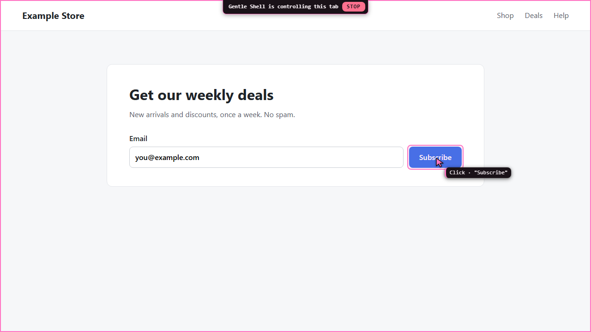
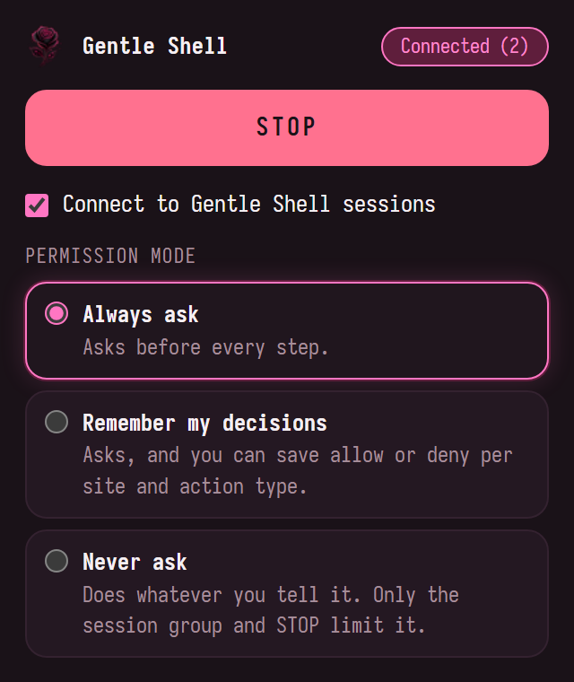

# Gentle Chrome

Let your Gentle Shell sessions drive the Chrome you already have open on Windows, using your profile, but **each one only inside its own tab group**, with a visible cursor and **a permission mode you choose**: ask before every step, remember your decisions per site and kind of step, or never ask.

New here? Read the step-by-step **[user guide](docs/GUIDE.md)**, with pictures of the popup and the on-page cursor.

It has two parts:

- **Pi package** (`src/`): loaded by Gentle Shell. Adds the `browser_*` tools and the `/browser` command. Each session serves an authenticated WebSocket on its own `127.0.0.1` port and registers itself locally.
- **Chrome extension** (`extension/`): "Gentle Shell Browser", loaded unpacked in Chrome. A small helper (a Chrome native messaging host) tells it the secret token and the live sessions; it connects to every one, enforces each session's tab group and the permission mode, and drives tabs through `chrome.debugger`, so pages receive real input events.

## How it works

```
WSL: Gentle Shell (Pi package)                      Windows: Chrome (Gentle Shell Browser)
──────────────────────────────                      ──────────────────────────────────────
agent ─ browser_* tool ─► ws://127.0.0.1:487xx ◄─── extension (Origin chrome-extension://…
   (one port per session)                            + mutual proof of the shared token)
                                                       │ 1. tab must be in this session's group
                                                       │ 2. mode decides: allow / ask / refuse
terminal prompt ◄── "approve" request ◄────────────────┘ 3. ghost cursor glides, then real input (CDP)
"Deny" / "Allow once" / "Always …" ────────────────►   STOP (page or popup) ─► aborts the agent run
```

The decision lives in the extension; the terminal only shows the question. A tool cannot skip a check, change the mode or save a decision. The extension finds the sessions and the token through the helper `dev.gentle.shell`, so there is nothing to pair.

## Quick path

1. Install the Pi package into Gentle Shell and restart it.
2. Run `scripts/install-extension.sh` once and load the extension unpacked in Chrome.
3. Ask the agent to open a page. It appears in a pink **Gentle · <session>** tab group.

## A quick look

While the agent works in a tab, you see what it does: a pink frame, a cursor that glides to the target, a label for each step and a **STOP** button. Your own mouse never moves, and the agent works in background tabs, so you keep browsing in yours.



The extension popup shows how many sessions are connected, the On/Off switch, the permission mode and STOP:



| Mode | What asks you |
|---|---|
| **Always ask** | Every step. |
| **Remember my decisions** | Asks, and you can save allow or deny per site and kind of step (for example, allow clicks on a site but keep asking before payments there). |
| **Never ask** | Nothing. Only the session's tab group and STOP limit it. |

**[Continue in the full guide →](docs/GUIDE.md)** for installing step by step, [using it](docs/GUIDE.md#4-using-it), [permission modes and saved decisions](docs/GUIDE.md#5-permission-modes), troubleshooting and uninstalling.

## Install

The [user guide](docs/GUIDE.md#3-install) walks through the same steps with checks and pictures.

### 1. Pi package

Install the dependencies once, then add the package to Gentle Shell:

```sh
git clone https://github.com/AndySabina/gentle-shell-browser.git
cd gentle-shell-browser
npm install
gentle-shell install "$PWD"
```

`gentle-shell install` runs Pi's own `install` against the Gentle Shell home. Instead, you can add the folder to the `packages` list in `~/.gentle-shell/agent/settings.json`; relative paths resolve from that file's folder:

```json
{ "packages": ["/absolute/path/to/gentle-shell-browser"] }
```

Restart Gentle Shell. The bridge starts with the session: `/browser status` prints `session "<name>" (<id>) listening on 127.0.0.1:<port>, Chrome not connected`. Each session takes the first free port from 48733 to 48832.

### 2. Install once: extension and helper

Chrome cannot reliably load an unpacked extension from a `\\wsl.localhost\…` path, so the script copies it to a Windows folder and installs the helper next to it:

```sh
scripts/install-extension.sh                      # default: %USERPROFILE%\gentle-shell-chrome
scripts/install-extension.sh 'D:\tools\gentle-chrome'  # or any folder (Windows or /mnt/… path)
```

- The extension goes to the target (by default `%USERPROFILE%\gentle-shell-chrome`).
- The helper goes to `<target>-host` and is registered for your Windows user under `HKCU\Software\Google\Chrome\NativeMessagingHosts\dev.gentle.shell` (no admin needed). Only this extension may start it: its id is fixed by the `key` in the manifest.

Then, once, in Chrome: `chrome://extensions` → turn on **Developer mode** → **Load unpacked** → choose the folder the script printed (by default `%USERPROFILE%\gentle-shell-chrome`).

The script refuses a non-empty folder that is not a previous copy (no `manifest.json` named "Gentle Shell Browser"), never deletes anything, and only writes inside the target.

**Updates are automatic.** The script stamps the copy with `build.json` (a hash of the extension's files) and records the folder in `~/.config/gentle-chrome/extension-target`. Whenever the extension connects with another build than your checkout's, Gentle Shell copies the new files into that folder and asks the extension to reload itself as soon as no action is running (it retries every 30 seconds, up to 10 times). `/browser update` does the same on demand.

An extension loaded before self-update existed cannot reload itself: Gentle Shell copies the files and asks you to press the reload icon on the Gentle Shell Browser card in `chrome://extensions` once. After that it updates itself.

## Sessions connect automatically

There is no pairing code. Every 30 seconds, when Chrome starts and whenever you open the popup, the extension asks the helper for the token and the live Gentle Shell sessions, then:

- connects to each new session (the toolbar badge shows **ON**, or the number of connected sessions);
- closes the connection of a session that ended;
- redials a session whose port changed;
- leaves the others alone.

A session entry the helper lists that is not valid is skipped; the other sessions still connect. Gentle Shell records each session's name trimmed, without control characters, at most 60 characters, and "session" when empty.

The popup shows how many sessions are connected in its status pill and has an **On/Off** switch ("Connect to Gentle Shell sessions"): Off closes every connection and stops connecting until you turn it On again. Check a single session from Gentle Shell with `/browser status`.

The token itself never travels over the socket. On every connection both sides exchange random nonces and prove they know the token with an HMAC that also names the session: Gentle Shell proves it first, then the extension. If whatever listens on a session's port cannot prove it (another program took the port), the extension closes that connection, stops retrying it and lists it as `untrusted`; turn the switch Off and On to try again.

## Use

Just ask, for example: "open github.com and find the latest issue in my repo". The agent opens tabs inside the group and you watch a rose ghost cursor glide to each target with a label of the action. Your real mouse never moves.

### Commands

| Command | Does |
|---------|------|
| `/browser` or `/browser status` | Shows this session's name, id and port, and whether Chrome is connected. |
| `/browser start` | Starts the bridge (it also starts with the session). |
| `/browser stop` | Stops the bridge; Chrome disconnects. |
| `/browser update` | Copies the extension to its recorded folder now and reloads it in Chrome if it runs another build. |
| `/browser level` | Shows the permission mode. |
| `/browser level always` | Switches to Always ask. |
| `/browser level remember` | Switches to Remember my decisions. |
| `/browser level never` | Asks you to confirm, then switches to Never ask. |
| `/browser rules` | Lists the saved decisions, one per line: `site — kind: allow` or `deny`. |
| `/browser rules clear` | Asks you to confirm, then clears every saved decision. |
| `/browser rules clear <site>` | Clears the saved decisions for one site. |

### Tools the agent gets

The agent sees these tools only while Chrome is connected to its session; until then they cost no tokens. `/browser status` works either way.

| Tool | Does |
|------|------|
| `browser_tabs` | Lists the tabs in the group (id, title, URL). |
| `browser_snapshot` | Reads a tab: URL, title, text and interactive elements as `[ref] role "name"` with only the flags that matter (`type=`, `value=`, `checked`, `disabled`). By default only the viewport: up to 80 elements on screen, the visible text (up to 1500 characters), and a count of the elements outside it. `full: true` reads the whole page (up to 300 elements, offscreen ones included, and 6000 characters of text). `details: true` adds each link's address (shortened: path and query on the same site, host and path elsewhere, 80 characters at most) and each element's center. The text leaves out what the listed elements already name. |
| `browser_act` | One step in a group tab, chosen by `action`: `click` (ref or x/y, any button, single or double click), `type` (into a field; can clear it first and press Enter after), `key` (`Enter`, `Control+a`, `Shift+Tab`…), `scroll` (mouse wheel at an element, a point or the viewport center), `navigate` (load a URL), `back`, `forward`, `reload`, and `open` (an http(s) URL in a new tab inside the group, creating the group if needed; needs no `tabId`). A step missing what its action needs is refused before anything reaches Chrome. The result says what happened, and the tab's title and URL only when the URL changed (always after a page load). |
| `browser_screenshot` | Captures what a tab shows as a JPEG, at most 1024 pixels wide. Fails after 5 s on a background tab, which Chrome does not paint. |

### Environment variables

| Variable | Default | Effect |
|----------|---------|--------|
| `GENTLE_CHROME_PORT` | first free of 48733–48832 | Pins this session's port. The extension only connects to ports in 48733–48832. |
| `GENTLE_CHROME_CONFIG_DIR` | — | Folder holding the token and the session records. |
| `XDG_CONFIG_HOME` | `~/.config` | Used when the variable above is unset: the token lives in `$XDG_CONFIG_HOME/gentle-chrome/token` (mode 0600), each session's record in `sessions/<id>.json`. |

## The tab groups

- **One group per session.** Each Gentle Shell session gets its own pink group titled **Gentle · <session name>**. When two running sessions share a name, the later ones are **Gentle · <name> · 2**, **· 3**… A name that ends in "(ended)" ends in "(ended session)" in the title, so no live group looks like an ended one.
- A session can only read or act on tabs in its own group. Any other tab id, including a tab in another session's group, gets "Tab N is not in the Gentle Shell group".
- The agent never switches tabs for you: it opens and works in its tabs in the background, so you keep browsing in yours. Switch to a group tab to watch the cursor.
- **Grant** a tab to a session by dragging it into that session's group. **Revoke** by dragging it out: the cursor and the debugger leave that tab at once.
- `browser_act` with `open` creates the session's group in your last focused window.
- A group you title exactly like a session's group yourself (for example "Gentle · docs") counts as granted to that session: it is adopted when its stored group is gone, unless another session owns it. A group whose title ends in " (ended)" is never adopted.
- **Ended sessions.** When a session ends, its group stays with its tabs and is renamed **Gentle · <name> (ended)**. No session ever uses it again; close it or reuse the tabs yourself. The extension remembers the live sessions, so a session that ended while Chrome or the extension was not running gets its group renamed at the next discovery.
- Actions run one at a time across all sessions.
- **Leaving the group stops an action.** Right before every input event the extension checks the tab again; if you dragged it out meanwhile (even during an approval prompt), the action fails with "Tab N left the Gentle Shell group; the action was cancelled." and nothing is sent. The debugger never attaches, or re-attaches, to a tab outside the group.
- **Tabs an agent action opens** (a `target=_blank` link, `window.open`, a middle click) are taken out of the group at once, even if Chrome put them there. The permission mode below then decides, as for opening a page: allowed → it joins the group; denied, no answer or STOP → it is closed.
- **Tabs a group tab opens later**, with no agent action running (for example a page's delayed `window.open`, or your own middle click in a group tab), are quietly taken out of the group if Chrome puts them there when they open or within 2 seconds. Nothing is asked and the tab stays open. Drag it back into the group to grant it; that is not undone.
- Tabs opened from tabs outside the group are never touched.

## Permission modes

Choose in the popup (applies at once) or with `/browser level`. Default: **Always ask**. No agent tool can read or change the mode or the saved decisions. An older install's levels carry over: Supervised becomes Always ask, Autonomous becomes Remember my decisions.

| Mode | What it does |
|------|--------------|
| **Always ask** (`always`) | Asks before every acting step: opening or loading a page (`open`, `navigate`, `back`, `forward` and `reload` steps, a click that loads a page, a tab an action opens), and every click, typing, key press and scroll. |
| **Remember my decisions** (`remember`) | Asks like Always ask, but the prompt also offers **Always allow … on \<site\>** and **Always deny … on \<site\>**. A saved decision answers that site and kind of step from then on, without asking. |
| **Never ask** (`never`) | Asks nothing: the agent does whatever you tell it. Only the session's tab group and STOP limit it. The popup and `/browser level never` ask you to confirm first. |

Reading (tabs, snapshot, screenshot) never asks. The tab group limit and STOP hold in every mode.

### Kinds of step

Every acting step has a **site**, the host of the page it acts on (for opening a page, of the destination) in lower case without `www.`, and a **kind**, decided by the extension, never by the agent:

| Kind | In the prompt | When |
|------|---------------|------|
| `money` | payments and transfers | A control named pay, buy, purchase, order, place order, checkout, transfer or donate (also pagar, comprar, transferir, donar); typing into a card or bank field; submitting a form with one; any step on a page with card or bank fields, an embedded payment form or a pay/transfer submit button; a risky verb on a billing or payment methods page. |
| `irreversible` | deleting, passwords and security changes | A control named delete, remove (also eliminar, borrar, quitar); typing into a password or one-time code field; submitting a form with a password field; any step on a page with a password field or a delete submit button; a risky verb on a page about passwords, two-factor, account deletion or security. |
| `navigate` | opening pages | Opening or loading a page, and a tab an action opens. |
| `click`, `type`, `key`, `scroll` | clicks, typing, key presses, scrolling | Any other step of that kind. Scrolling is always `scroll`: it cannot pay or delete. |

When a step matches both, `money` wins over `irreversible`. The detection is listed under [Risky actions](#risky-actions) and [Risky pages](#risky-pages); what it found is shown on the prompt's `Why:` line.

### Saved decisions (Remember my decisions)

- A decision is saved per site and kind. One kind never covers another: **Always allow clicks on mercadopago.com** still asks before a payment there, and nothing saved for `mercadopago.com` covers `mercadopago.com.ar`.
- A saved **allow** goes ahead without asking. A saved **deny** refuses without asking: "The user did not approve: … (saved rule: deny money on mercadopago.com)".
- The agent can still raise: `risky: true` asks even over a saved allow. A page whose content could not be read is never covered by a saved allow either.
- A page without a host (such as `about:blank`) has no site: in this mode it always asks and offers no saving.
- Manage them in the popup (a **Saved decisions** list, shown in Remember mode, with **Remove** on each and **Clear all**) or with `/browser rules`. Only you save decisions: the extension accepts one only as the answer to a prompt that offered it.

### The prompt

The prompt appears in the Gentle Shell terminal with **Deny** (listed first, the default) and **Allow once**; in Remember my decisions also **Always allow \<kind\> on \<site\>** and **Always deny \<kind\> on \<site\>**. Anything else counts as no: no answer in 5 minutes, no terminal UI, Chrome disconnected, STOP, or an error. A denied step fails with "The user did not approve: …" and the agent is told not to retry it. Text from the page is cleaned before it reaches the terminal: control characters, bidi overrides and line separators are removed.

An approval covers that exact address and the server redirects of that request. Any other page load in the same action (a second navigation the page starts on its own, a script redirect) is decided again by the mode. A risky page is covered as a redirect only by that exact address or by the mode itself (Never ask, or a saved allow for its site).

### Risky actions

These decide a step's kind (`money`, `irreversible` or its plain kind) and its `Why:` line; whether it asks is up to the mode.

- Typing into a password, payment card, one-time code or IBAN/CVV field.
- Pressing Enter in a message box (textarea or rich editor).
- Submitting a form: Enter or a `type` step with submit inside a form, or clicking (or pressing Enter/Space on) a submit button. Search forms are the exception: a `role=search` landmark, a search field, an action address containing "search", or a single text field named `q`, `query`, `search` or `s`. A form with a password or payment field is always risky.
- Clicking a control, or pressing Enter or Space on a focused button or link, whose name says pay, buy, order, checkout, send, delete, remove, publish, post, transfer, confirm, unsubscribe, sign (not sign in/up/out/on), donate, cancel subscription, or the Spanish equivalents (pagar, comprar, enviar, eliminar, borrar, quitar, publicar, transferir, confirmar, firmar, donar).
- Input on a target the extension cannot inspect: no element there, an iframe, frame, embed or object, or an unnamed shadow-DOM component. (Tab, Shift+Tab and Escape are exempt.)

Right before pressing, the extension checks that the element under the cursor is still the target. If the page moved, it looks the element up once more and glides there; if it is still covered, the action fails with "The page moved under the cursor; take a new browser_snapshot." and nothing is pressed.

### Risky pages

Risky pages are detected automatically; you do not have to list them. As with risky actions, this decides a step's kind and `Why:` line, not whether it asks. Right before every click, typing, key press or scroll, the extension reads the page (main frame, visible elements only) and treats it as risky when it has:

- a password field;
- a payment card, one-time code or bank account field: autocomplete `cc-*` or `one-time-code`, or a name, id or label about card number, CVV/CVC, expiry, IBAN, routing or account number (also `tarjeta`, `vencimiento`, `cuenta`, `CLABE`, `CBU`);
- a form submit control whose name is one of the risky verbs above (pay, send, transfer, delete…);
- an embedded payment form from Stripe, PayPal, Mercado Pago, Adyen, Braintree, Checkout.com or Square;
- a title or heading about account security or billing: change password, two-factor, delete account, billing, payment methods, security (and `cambiar contraseña`, `verificación en dos pasos`, `eliminar cuenta`, `facturación`, `métodos de pago`, `seguridad`);
- content that cannot be read.

A page also counts as risky by its address when:

- its host starts with `admin`, or contains `bank`, `banking`, `banco`, `wallet` or `billing`;
- its path has a segment `checkout`, `billing`, `payment(s)`, `pay`, `admin`, `settings`, `security`, `password`, `account(s)` or `wallet`;
- its address cannot be read;
- it is on the built-in list of payment, mail, account and cloud console domains (not editable).

Before a navigation the destination's content is unknown, so only its address is named in the prompt. Right after a page loads, the extension reads it and tells the agent when it looks sensitive (`browser_snapshot` shows a `Risk:` line too); nothing pauses then, but the next action on that page is `money` or `irreversible` when its content says so.

**The agent can only raise risk.** `browser_act` takes an optional `risky` flag for every action but `scroll`. `risky: true` makes that step ask in Always ask and Remember my decisions, even over a saved allow ("the agent marked this step as sensitive"); it has no effect in Never ask. `false`, or any other value, changes nothing, so the agent can never skip an approval the mode requires.

**The built-in list is not editable.** A page on it is reported to the agent as sensitive and named on the prompt's `Why:` line; it does not add a prompt by itself. An entry is a domain, which covers its subdomains, optionally with a path prefix such as `github.com/settings`. It covers payment providers, banks, webmail, account pages and cloud consoles (PayPal, Stripe, Mercado Pago, Google/Microsoft/Apple accounts, Gmail, Outlook, AWS, Azure, GCP…).

## Safety model

| Layer | Guarantee |
|-------|-----------|
| Bridge | Listens on `127.0.0.1` only. Accepts a connection only from a `chrome-extension://` Origin that completes the HMAC challenge-response within 5 seconds and sends at most 4 KiB before it does; the token is never sent. The extension talks only to a listener that proved it knows the token. One extension at a time. |
| Group | Every tab-scoped request goes through the calling session's group check in the extension, repeated before every input event; the debugger attaches only to tabs in a live session's group. |
| Actions | One at a time across all tabs (the tools also run sequentially). |
| Policy | Decided in the extension from settings only you change: the popup, `/browser level` (which confirms before Never ask), `/browser rules`, and the Always allow/deny answers to its own prompts. |
| Sessions | The helper only answers this extension's fixed id. Each connection is bound to one session id; a session reads and acts only on its own group, and its approvals are asked in its own terminal. |
| Approval | Asked in the terminal of the session that started the action; any failure is a denial. |
| STOP | The **STOP** button on the page fails the running and waiting actions of the session acting on that tab ("Stopped by the user in Chrome."), removes the cursor from their tabs and aborts that session's run; other sessions' actions go on. When no other action is left it also detaches the debugger. The popup's **STOP** stops every session's actions, detaches the debugger and aborts every connected session's run. When a session disconnects, the extension stops only that session's actions, or removes the cursor and the debugger from its tabs. |
| Visibility | While the debugger is attached, Chrome shows its "started debugging this browser" bar. Cancelling it detaches; the next action attaches again. |

## Look and feel

The popup and the on-page cursor, highlight, label and STOP banner follow the [Gentleman Programming](https://gentlemanprogramming.com/) dark rose palette. The popup uses Iosevka, bundled in `extension/fonts/` (latin 400/700 from `@fontsource/iosevka` 5.3.0, SIL Open Font License 1.1, see `extension/fonts/OFL.txt`). Pages cannot load extension fonts without exposing them to every site, so the on-page overlay uses Iosevka Term or JetBrains Mono when installed and falls back to the system monospace font.

## Limitations

- **Some page changes cannot be paused.** Navigation is paused only when a new document is requested from the network. In-page (SPA) route changes, pages restored from the back-forward cache and prerendered pages that Chrome activates never make that request. They are detected afterwards: the cursor label shows "Page changed without approval → …" and the agent is told. Service workers are bypassed during an action so their navigations do reach the check; for that the extension turns on the debugger's Network domain for the action's duration.
- **iframes are not inspected.** Snapshots skip their content (and say how many there are); sub-frame loads are not paused.
- **Your own navigation in the acting tab** during the 1.5 seconds after an agent action is treated as the agent's and asked too.
- **Late new tabs.** A tab Chrome adds to the group more than 2 seconds after a group tab opened it, with no action running, stays in the group. A tab you drag into the group within those 2 seconds may be taken out once; drag it again.
- **Detectable by anti-bot sites.** Attaching the debugger enables `Runtime`, which some sites detect.
- **Up to 100 sessions** (ports 48733–48832) at the same time.
- **Chrome restart.** Group ids change; a restored group with the session's title is adopted by its title. If Chrome does not restore it, the next `open` step creates a new one. A group whose session ended while the extension was not running is renamed "(ended)" at the next discovery.
- **The helper starts WSL.** Each discovery runs the helper through `wsl.exe`, which takes a moment; the popup may show `Looking for Gentle Shell…` briefly.
- **A held new tab** whose web address does not show within 3 seconds (for example a blank `window.open`) is asked for in Remember my decisions even with saved allows: it has no site yet.

## Troubleshooting

| Symptom | Fix |
|---------|-----|
| Popup says **Gentle Shell helper not installed — run scripts/install-extension.sh once** | Run the script; it registers the helper. If it still shows, reload the extension once in `chrome://extensions`. |
| Popup says **Gentle Shell helper sent an invalid reply** | The helper and the extension come from different checkouts: run `scripts/install-extension.sh` again. |
| A session never connects (**untrusted**) | The listener on its port could not prove it knows the token: another program took the port. Turn the popup switch Off and On; restart that Gentle Shell session if it persists. |
| No sessions listed, or a session stays **waiting** | Check `/browser status` in that session; run `/browser start`. A `GENTLE_CHROME_PORT` outside 48733–48832 is never connected. |
| A session disconnects (**replaced**) | Another Chrome profile or window with the extension took that session. Turn the switch Off and On to take it back. |
| "Tab N is not in the Gentle Shell group" | Drag the tab into this session's group, or ask the agent to open a page (`browser_act` with `open`). |
| Every step is denied | Check the terminal for the prompt; answers time out after 5 minutes. |
| A step is denied without a prompt ("saved rule: deny …") | You saved Always deny for that site and kind: `/browser rules` lists it; `/browser rules clear <site>` or the popup removes it. |
| Changes do not show in Chrome | Run `/browser update`. If it says no folder is recorded, run `scripts/install-extension.sh` once. If it asks for a manual reload, press reload on the card in `chrome://extensions` once. |

## Development

```sh
pnpm install
node --test "test/**/*.test.ts"   # unit tests (Node 22.18+, no build step)
npx tsc --noEmit                  # type check (src, test and the extension JS they import)
```

| Path | Contents |
|------|----------|
| `src/index.ts` | Pi extension entry: `/browser` command, tools, approval prompt wiring. |
| `src/bridge.ts`, `src/token.ts` | Authenticated loopback WebSocket and the shared token. |
| `src/sessions.ts`, `src/host.ts` | Per-session ports and records; the native messaging host that lists them. |
| `src/update.ts` | Build id, the extension copy used by the install script, and self-update. |
| `src/tools.ts`, `src/approval.ts` | The `browser_*` tools and the terminal approval prompt. |
| `extension/background.js` | Service worker: wiring, discovery, popup requests. |
| `extension/lib/sessions.js` | Discovery reply check, one connection and group per session, per-session request table, approval and STOP routing. |
| `extension/lib/group.js` | The tab group boundary. |
| `extension/lib/policy.js`, `navguard.js` | Permission modes, kinds of step, saved decisions, risky pages and actions, the navigation pause and new-tab hold. |
| `extension/lib/actions.js`, `overlay.js` | Input through CDP and the ghost cursor. |
