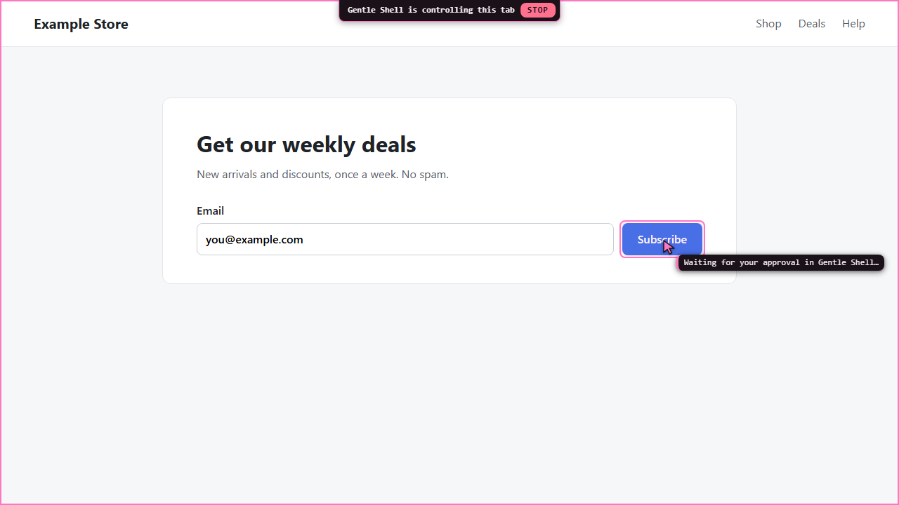
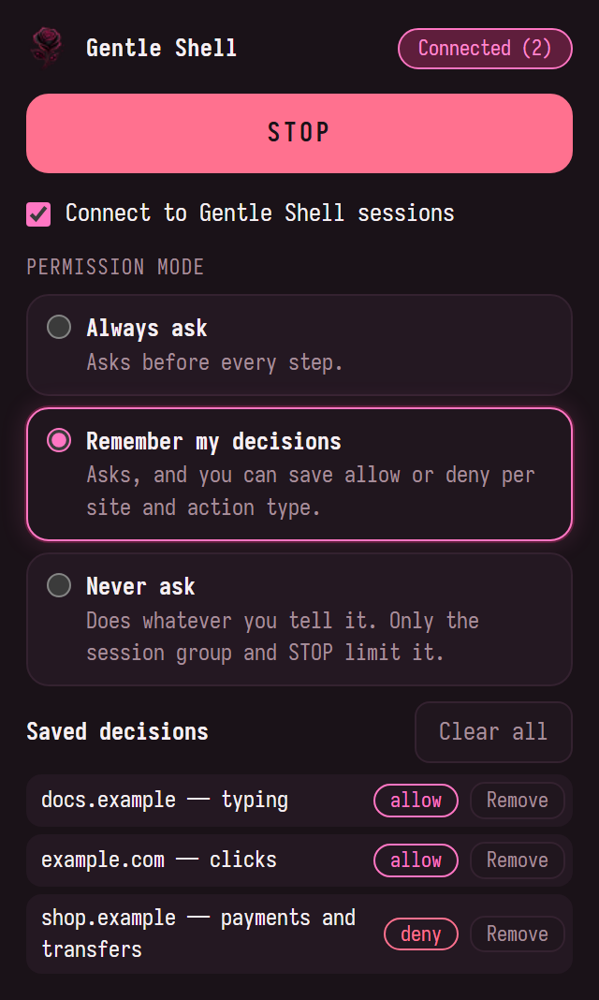
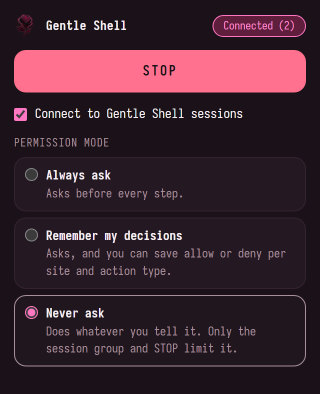
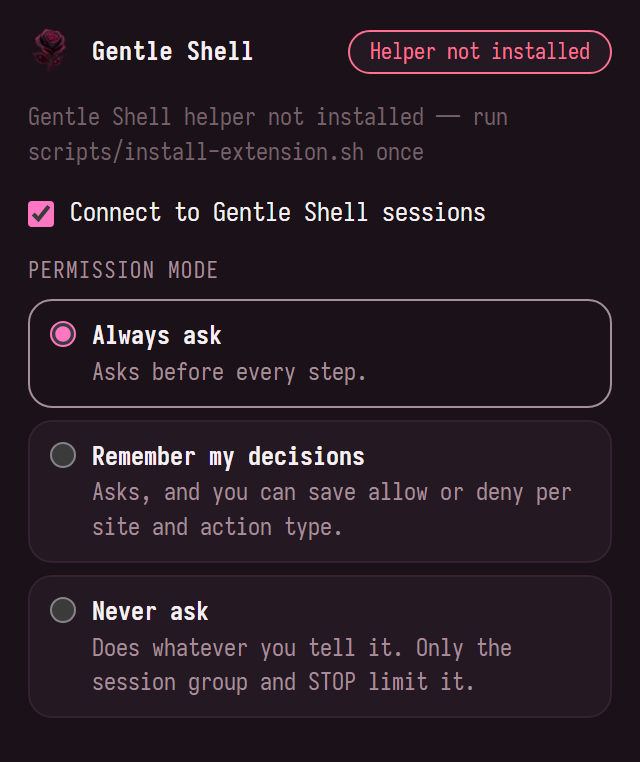

# Gentle Chrome user guide

Set up Gentle Chrome, let your Gentle Shell sessions work in your Chrome, and stay in control of what they do. For the full technical reference, see the [README](../README.md).

**Contents:** [What it is](#1-what-it-is) · [Requirements](#2-requirements) · [Install](#3-install) · [Using it](#4-using-it) · [Permission modes](#5-permission-modes) · [Risky page detection](#6-risky-page-detection) · [Several sessions](#7-several-gentle-shell-sessions-at-once) · [Updates](#8-updates) · [Commands](#9-commands) · [Troubleshooting](#10-troubleshooting) · [Privacy and safety](#11-privacy-and-safety) · [Uninstall](#12-uninstall)

## 1. What it is

Gentle Chrome lets the agent in your Gentle Shell session (running in WSL) use the Chrome you already have open on Windows, with your profile and your logins. Each session works **only inside its own tab group**, you watch a pink cursor glide to everything it touches, and **you choose a permission mode**: ask before every step, remember your decisions per site and kind of step, or never ask. A **STOP** button is always one click away.

It has two parts that talk over your own computer only:

```
WSL                                                Windows
───                                                ───────
Gentle Shell session                               Chrome
 └─ Pi package (src/)                               └─ "Gentle Shell Browser" extension (extension/)
     • browser_* tools for the agent                    • finds your sessions through a small helper
     • /browser, your commands                          • keeps each session inside its own tab group
     • approval prompt in your terminal                 • applies your permission mode
            ▲                                           • moves the pink cursor, then sends real input
            │      127.0.0.1 (local only, one port per session, secret token)
            └───────────────────────────────────────────┘
```

The extension makes every decision. The terminal only shows you the question, and nothing the agent sends can skip a check, change your mode or save a decision.

## 2. Requirements

| You need | Version |
|----------|---------|
| Windows with WSL2 | Gentle Shell runs in WSL; Chrome runs on Windows. |
| Google Chrome | 120 or newer, on Windows. |
| Gentle Shell (Pi) | Installed in WSL. |
| Node.js | 22.18 or newer, in WSL. |
| Git and npm | In WSL, to get the code. |

## 3. Install

Do this once. It takes about five minutes.

### Step 1. Get the code

```sh
git clone <this repository's URL> gentle-shell-browser
cd gentle-shell-browser
npm install
```

Keep this folder: the helper Chrome starts runs from it.

### Step 2. Add the package to Gentle Shell

Choose one way:

| Way | How |
|-----|-----|
| Command | Run `gentle-shell install "$PWD"` inside the folder. |
| Settings file | Add the folder's absolute path to the `packages` list in `~/.gentle-shell/agent/settings.json`, for example `{ "packages": ["/home/you/gentle-shell-browser"] }`. |

### Step 3. Install the extension and its helper

```sh
scripts/install-extension.sh
```

It writes three things, all for your Windows user only (no admin needed):

| What | Where |
|------|-------|
| The extension | `%USERPROFILE%\gentle-shell-chrome` |
| The helper (it tells the extension which sessions are running and the secret token) | `%USERPROFILE%\gentle-shell-chrome-host` |
| The helper's registration | Registry key `HKCU\Software\Google\Chrome\NativeMessagingHosts\dev.gentle.shell` |

To use another folder, pass it as the only argument. A Windows path or a `/mnt/…` path both work; the helper goes to the same path with `-host` added:

```sh
scripts/install-extension.sh 'D:\tools\gentle-chrome'
```

The script never deletes anything, only writes inside that folder, and refuses a non-empty folder that is not an earlier copy of the extension. At the end it prints the folder to load in Chrome.

### Step 4. Load the extension in Chrome

1. Open `chrome://extensions` in Chrome.
2. Turn on **Developer mode** (top right).
3. Press **Load unpacked**.
4. Choose the folder the script printed (by default `%USERPROFILE%\gentle-shell-chrome`).
5. Optional: pin **Gentle Shell Browser** from the puzzle-piece menu so its icon stays in the toolbar.

### Step 5. Restart Gentle Shell

Close and open Gentle Shell so it loads the package. The connection starts by itself with the session; there is no code to pair.

### How to check it worked

1. In Gentle Shell, run `/browser status`. It prints the session name and port, for example `session "my-app" (…) listening on 127.0.0.1:48733`, and whether Chrome is connected. Chrome connects within 30 seconds, or at once when you open the popup. The agent gets its `browser_*` tools only while Chrome is connected, so they cost no tokens before that.
2. Optionally, click the extension icon in Chrome. The popup's status pill shows **Connected (N)** with the number of connected sessions, and the toolbar badge shows **ON** (or that number).


If `/browser status` says Chrome is not connected, see [Troubleshooting](#10-troubleshooting).

## 4. Using it

### Ask in plain words

Talk to the agent as usual, for example:

- "Open example.com and tell me what the pricing page says."
- "Fill the contact form on the tab I gave you with my work details, but don't send it."
- "Find the latest issue in my repository on GitHub."

### The tab group

| What you see | What it means |
|--------------|---------------|
| A pink group titled **Gentle · \<session name\>** | The tabs this session may read and act on. The agent creates it when it first opens a page. |
| **Gentle · \<name\> · 2** | A second running session with the same name. |
| **Gentle · \<name\> (ended)** | The session ended. The tabs stay for you; no session uses that group again. |

- **Lend a tab:** drag one of your tabs into the session's group.
- **Take it back:** drag it out. The cursor leaves at once, and an action in progress there is cancelled before its next input.
- Tabs outside the group are never read or touched.
- When an action opens a new tab (a link with `target=_blank`, a pop-up), that tab is held out of the group until your permission mode allows it.

### It never steals your focus

The agent works in background tabs. You keep browsing in your own tabs and windows. Switch to one of its tabs whenever you want to watch.

One limit: Chrome does not paint background tabs, so the agent's **screenshot** of a background tab can fail after 5 seconds. Its page reading (snapshot) works anyway. Switch to the tab if you want screenshots to work.

### How the agent reads a page

A page reading (snapshot) covers what fits in the tab's view: up to 80 buttons, links and fields on screen, and the visible text. It also tells the agent how many elements are outside the view, so the agent scrolls, or asks for the whole page with `full: true` (up to 300 elements and more text). Reading only the view keeps each step cheap in tokens.

Each element is one short line, such as `[e12] button "Subscribe"`, plus a field's type and value and whether it is checked or disabled. The page text leaves out what those lines already name. Link addresses and screen positions are left out unless the agent asks for them with `details: true`. Screenshots are at most 1024 pixels wide.

### Watching what it does

Before every click, typing, key press or scroll, the cursor glides to the target and a label says what comes next. Your real mouse never moves.


| Part | Meaning |
|------|---------|
| Pink frame around the page | Gentle Shell controls this tab right now. |
| Banner at the top with **STOP** | Stops this session's work at once. |
| Pink cursor and highlighted box | The element it is about to act on. |
| Label next to the cursor | The action, for example `Click · "Subscribe"`, `Type · "Email"`, `Key · Enter` or `Scroll ↓`. |

When the step needs your approval, the label changes and the cursor waits on the target until you answer in the terminal:



### STOP

| Where | What it stops |
|-------|---------------|
| **STOP** in the page banner | The session working in that tab: its running and waiting actions fail with "Stopped by the user in Chrome." and its agent run is aborted. Other sessions go on. |
| **STOP** in the popup | Every session: all actions stop, the debugger detaches, and every connected session's run is aborted. |

## 5. Permission modes

Pick the mode in the popup (it applies at once) or with `/browser level`. The default is **Always ask**.

| Mode | Asks before | Good for |
|------|-------------|----------|
| **Always ask** (`always`) | Every acting step: opening or loading a page, every click, typing, key press and scroll, and every new tab an action opens. | Watching closely, new sites, anything sensitive. |
| **Remember my decisions** (`remember`) | The same steps, unless you saved a decision for that site and kind of step. Each prompt offers to save one. | Day-to-day use: allow the routine, keep asking for the rest. |
| **Never ask** (`never`) | Nothing. The popup and `/browser level never` ask you to confirm before switching. | Trusted, unattended work. |

Reading the group's tabs (listing them, page text, screenshots) never asks.

### Kinds of step

Each prompt and each saved decision is about a **site** (the page's host, in lower case, without `www.`) and a **kind** of step. The extension decides the kind; the agent cannot.

| Kind | When |
|------|------|
| opening pages | Opening or loading a page, and a new tab an action opens. |
| clicks | Any other click. |
| typing | Any other typing. |
| key presses | Any other key press. |
| scrolling | Scrolling (it can never pay or delete). |
| payments and transfers | Pay, buy, order, checkout, transfer or donate buttons; typing into card or bank fields; any step on a page with such fields, an embedded payment form or a pay/transfer submit button; a risky button on a billing page. |
| deleting, passwords and security changes | Delete or remove buttons; typing into password or one-time code fields; any step on a page with a password field or a delete submit button; a risky button on a page about passwords, two-factor or account security. |

When a step is both, it counts as **payments and transfers**.

### The prompt

The question appears in the Gentle Shell terminal of the session that asked. **Deny** is listed first and is the default.

In **Always ask**:

```
Gentle Shell wants to open https://docs.example/start in a new tab
Open a new tab in the Gentle Shell group.
URL: https://docs.example/start
Why: Always ask mode asks before every step
Mode: Always ask

  Deny
  Allow once
```

In **Remember my decisions**, two more answers save your decision:

```
Gentle Shell wants to click "Add to cart" on shop.example
Click in tab 412.
URL: https://shop.example/products/mug
Why: no saved decision for clicks on shop.example
Mode: Remember my decisions

  Deny
  Allow once
  Always allow clicks on shop.example
  Always deny clicks on shop.example
```

| Answer | What happens |
|--------|--------------|
| **Deny** | The step does not happen. The agent is told you did not approve it and not to retry. |
| **Allow once** | This one step goes ahead. |
| **Always allow \<kind\> on \<site\>** | The step goes ahead, and that kind on that site no longer asks. |
| **Always deny \<kind\> on \<site\>** | The step does not happen, and that kind on that site is refused from now on without asking. |
| No answer in 5 minutes, Chrome disconnected, STOP | Same as Deny. |

The `Why:` line names what made the step sensitive, for example `typing into a password field` or `acting on a risky page: the page path has "/checkout"`.

### Saved decisions

In **Remember my decisions** the popup lists what you saved, with **Remove** on each and **Clear all**:



- A decision covers one site and one kind only. **Always allow clicks on shop.example** still asks before a payment there, and nothing saved for `shop.example` covers `pay.shop.example`.
- You can also manage them from the terminal:

| Command | Does |
|---------|------|
| `/browser rules` | Lists every saved decision as `site — kind: allow` or `deny`. |
| `/browser rules clear <site>` | Forgets the decisions for one site. |
| `/browser rules clear` | Asks you to confirm, then forgets all of them. |

### Never ask



Nothing asks for approval, payments and deletions included. Two limits still hold in every mode:

- the session only touches tabs in its own group;
- STOP, on the page and in the popup, works as always.

### Who can change what

- **Only you change the mode and the saved decisions**: in the popup, with `/browser level` and `/browser rules`, or by answering a prompt. No agent tool can read or change them.
- **The agent can only raise risk.** It may mark a step as sensitive, which makes it ask in Always ask and Remember my decisions even over a saved allow. It can never skip a question your mode requires.

## 6. Risky page detection

You do not have to list risky sites. Right before every click, typing, key press or scroll, the extension reads the page and treats it as risky when it has:

- a password field;
- a payment card, one-time code or bank account field (card number, CVV, expiry, IBAN, routing or account number…);
- a submit button named pay, send, transfer, delete or a similar risky word;
- an embedded payment form from Stripe, PayPal, Mercado Pago, Adyen, Braintree, Checkout.com or Square;
- a title or heading about change password, two-factor, delete account, billing, payment methods or security;
- content it cannot read.

The address counts too:

- a host that starts with `admin` or contains `bank`, `banking`, `banco`, `wallet` or `billing`;
- a path with `checkout`, `billing`, `payment(s)`, `pay`, `admin`, `settings`, `security`, `password`, `account(s)` or `wallet`;
- a built-in list of payment, mail, account and cloud console sites (not editable).

What detection changes: the step's kind (it becomes **payments and transfers** or **deleting, passwords and security changes**) and the `Why:` line of the prompt. Whether it asks is still up to your mode. The agent is also told when a page looks sensitive.

## 7. Several Gentle Shell sessions at once

Open as many Gentle Shell sessions as you like (up to 100). Each one:

- listens on its own port, the first free one from 48733 to 48832;
- gets its own pink group, **Gentle · \<session name\>**;
- only sees and acts on its own group's tabs;
- asks for approval in its own terminal.

The popup lists every session with its state. Actions from all sessions run one at a time. STOP on a page stops only the session working in that tab.

## 8. Updates

Updates are automatic. When you pull new code, the next time the extension connects with an older build, Gentle Shell copies the new files into the extension's folder and asks it to reload itself as soon as no action is running.

To update right away, run `/browser update`.

If it asks for a manual reload (only for copies installed before self-update existed), press the reload icon on the **Gentle Shell Browser** card in `chrome://extensions` once.

## 9. Commands

Run these in Gentle Shell.

| Command | Does |
|---------|------|
| `/browser` or `/browser status` | Shows this session's name, id and port, and whether Chrome is connected. The agent's browser tools appear only while it is. |
| `/browser start` | Starts the connection (it also starts with the session). |
| `/browser stop` | Stops the connection; Chrome disconnects from this session. |
| `/browser update` | Copies the extension to its folder now and reloads it in Chrome if it runs another build. |
| `/browser level` | Shows the permission mode. |
| `/browser level always` | Switches to Always ask. |
| `/browser level remember` | Switches to Remember my decisions. |
| `/browser level never` | Asks you to confirm, then switches to Never ask. |
| `/browser rules` | Lists the saved decisions. |
| `/browser rules clear` | Asks you to confirm, then clears every saved decision. |
| `/browser rules clear <site>` | Clears the saved decisions for one site. |

The agent itself gets four tools, only while Chrome is connected to its session:

| Tool | Does |
|------|------|
| `browser_tabs` | Lists the tabs in the session's group. |
| `browser_snapshot` | Reads a tab (see [How the agent reads a page](#how-the-agent-reads-a-page)). |
| `browser_act` | Takes one step: click, type, press a key, scroll, load a page, go back or forward, reload, or open a new tab in the group. Each step follows your permission mode. |
| `browser_screenshot` | Captures what a tab shows, at most 1024 pixels wide. |

## 10. Troubleshooting

| Symptom | Fix |
|---------|-----|
| The popup says **Gentle Shell helper not installed — run scripts/install-extension.sh once** (picture below) | Run `scripts/install-extension.sh`; it registers the helper. If the message stays, reload the extension once in `chrome://extensions`. |
| The popup says **Gentle Shell helper sent an invalid reply** | The helper and the extension come from different copies of the code. Run `scripts/install-extension.sh` again. |
| `/browser status` keeps saying Chrome is not connected | Run `/browser start` in that session. Open the popup to make the extension look again, and check that its switch is on. |
| A session never connects (**untrusted**) | Another program answered on that session's port and could not prove it knows the secret. Turn the popup switch Off and On; if it persists, restart that Gentle Shell session. |
| A session disconnects (**replaced**) | Another Chrome profile with the extension took that session. Turn the switch Off and On to take it back. |
| "Tab N is not in the Gentle Shell group" | Drag the tab into this session's group, or ask the agent to open the page itself. |
| The agent's screenshot fails after 5 seconds | Chrome does not paint background tabs. Switch to the tab, or let the agent read the page text instead. |
| Every step is denied | Look for the prompt in the terminal of the session that asked; it times out after 5 minutes. |
| A step is denied without a prompt ("saved rule: deny …") | You saved Always deny for that site and kind. `/browser rules` lists it; `/browser rules clear <site>` or **Remove** in the popup forgets it. |
| The mode is back to **Always ask** and saved decisions are gone | The extension was removed and loaded again; Chrome deletes an extension's data when you remove it. Reloads and updates keep them. Choose your mode again. |
| Gentle Shell reports "No free port between 48733 and 48832" | All ports from 48733 to 48832 are busy: close sessions you no longer use, or set `GENTLE_CHROME_PORT` to a free port in that range. A port outside it is never connected. |
| Changes do not show in Chrome | Run `/browser update`. If it says no folder is recorded, run `scripts/install-extension.sh` once. |



## 11. Privacy and safety

| Topic | How it works |
|-------|--------------|
| Network | Everything stays on your computer. Each session listens on `127.0.0.1` only and accepts only this extension, which must prove it knows the secret token. The token itself never travels. |
| What is stored | The token and the list of running sessions in `~/.config/gentle-chrome/` (WSL). Your mode and saved decisions in the extension's own Chrome storage. Nothing is sent anywhere else. |
| The debugger bar | While the agent acts, Chrome shows its "started debugging this browser" bar. That is expected: it is how pages receive real clicks and typing. Cancelling it detaches; the next action attaches again. |
| Page text | Pages can contain text written to trick an AI. The agent receives page text marked as untrusted, with the instruction never to follow it, and the extension, not the agent, decides what needs your approval. Text shown in the prompt is cleaned of control characters. |
| Your profile | The agent uses your logged-in sessions, but only in tabs inside its group. Keep sensitive tabs out of the group. |
| Detection | Some sites can detect the debugger and treat the tab as automated. |

## 12. Uninstall

1. In Chrome, open `chrome://extensions` and press **Remove** on **Gentle Shell Browser**.
2. Delete the two folders the install script created (by default `%USERPROFILE%\gentle-shell-chrome` and `%USERPROFILE%\gentle-shell-chrome-host`).
3. Remove the helper's registration. From WSL:

   ```sh
   reg.exe delete 'HKCU\Software\Google\Chrome\NativeMessagingHosts\dev.gentle.shell' /f
   ```

   Or from a Windows Command Prompt:

   ```bat
   reg delete "HKCU\Software\Google\Chrome\NativeMessagingHosts\dev.gentle.shell" /f
   ```

4. Remove the package from Gentle Shell: delete its path from the `packages` list in `~/.gentle-shell/agent/settings.json`, then restart Gentle Shell.
5. Delete the local state in WSL: `~/.config/gentle-chrome` (the token, the session records and the recorded extension folder).
6. Delete the cloned folder if you no longer need it.

---

The pictures in this guide are real renders of the extension's popup and page overlay with made-up data. To regenerate them, run `scripts/capture-screenshots.sh` (see `docs/harness/`).
